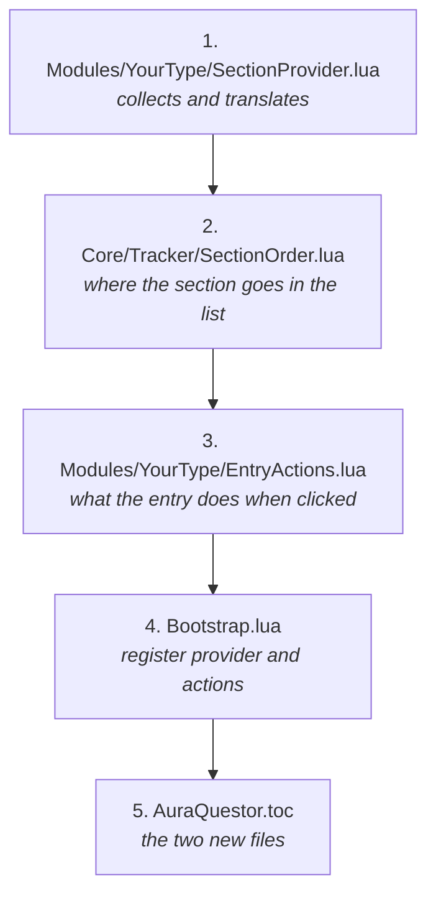

# Adding a content type

**English** | [Português](pt-BR/adicionar-conteudo.md)

This is the most common extension in the project. It takes a new folder and a
registration in the composition root; no existing code changes.

## The five steps



## 1. The provider

Implements the [`SectionProvider`](../Source/Ports/SectionProvider.lua) port, which has one
method. Its responsibility is to read the game API and return the common
structure.

```lua
local _, Addon = ...

local ENTRY_KIND = "yourType"

---@class YourTypeSectionProvider : SectionProvider
local YourTypeSectionProvider = {}
YourTypeSectionProvider.__index = YourTypeSectionProvider

---@return YourTypeSectionProvider
function YourTypeSectionProvider.New()
	return setmetatable({}, YourTypeSectionProvider)
end

---@return TrackerSection[]
function YourTypeSectionProvider:Collect()
	local entries = {}

	for _, id in ipairs(C_YourApi.GetTrackedThings() or {}) do
		local info = C_YourApi.GetInfo(id)

		-- Data the game has not loaded yet arrives as nil. Skipping it is better
		-- than drawing a blank row.
		if info and info.name then
			table.insert(entries, {
				id = id,
				kind = ENTRY_KIND,
				title = info.name,
				objectives = {},
				isComplete = info.completed == true,
				canFindGroup = false,
			})
		end
	end

	return {
		{
			id = "yourType",
			title = YOUR_BLIZZARD_GLOBAL,
			order = Addon.SectionOrder.yourType,
			entries = entries,
		},
	}
end

Addon.YourTypeSectionProvider = YourTypeSectionProvider
```

Three conventions to follow:

**Use the Blizzard global as the title** when one exists
(`TRACKER_HEADER_QUESTS`, `ADVENTURE_TRACKING_MODULE_HEADER_TEXT`). It already
comes translated into every client language.

**`Collect` returns a list**, not a section. One source can feed more than one:
the quests provider returns campaign and quests in separate sections.

**There is no need to handle an empty section.** `TrackerContent` drops sections
with no entries before sorting.

If the API exposes a list of ids plus a lookup by id, and describes progress as
`requirementsList`, use
[`TrackedListSectionProvider`](../Source/Modules/TrackedListSectionProvider.lua) instead
of writing a provider. It takes a configuration table. Traveler's Log and
Endeavors share this implementation.

## 2. The section order

One line in [`Core/Tracker/SectionOrder.lua`](../Source/Core/Tracker/SectionOrder.lua),
where the section `id` is the key. The file holds the order of every section.

```lua
yourType = 45,
```

There is a test that fails if two sections get the same number.

The section shows up on its own in the reorder list of the options panel, but
its label comes from a map in
[`Options/SectionOrderCard.lua`](../Source/Options/SectionOrderCard.lua), which
maps the `id` to the already translated Blizzard global:

```lua
yourType = "YOUR_BLIZZARD_GLOBAL",
```

There is a test for this too: forgetting that line makes the suite fail instead
of showing the raw id to the player.

## 3. The actions

Only needed if the entry responds to clicks. The port is
[`EntryActions`](../Source/Ports/EntryActions.lua) and its methods are **optional**: the
router checks for each one before calling it, so implement only the ones that
apply.

| Method | When |
|---|---|
| `OpenDetails` | left click on the block |
| `MenuItems` | right click; an empty list means no menu |
| `SuperTrack` | click on the pin |
| `Untrack` | menu item and Shift + right click |
| `Describe` | tooltip text |
| `Rewards` | rewards in the tooltip |
| `FindGroup` | the green eye for group content |

A scenario has no page to open and cannot be untracked, which is why
[`Modules/Scenario/EntryActions.lua`](../Source/Modules/Scenario/EntryActions.lua)
implements almost nothing.

## 4. Register

Two lines in [`Bootstrap.lua`](../Source/Bootstrap.lua), the only file in the project
that knows concrete implementations:

```lua
-- in the TrackerContent providers list
Addon.YourTypeSectionProvider.New(),

-- in the EntryActionRouter table, keyed by the entry kind
yourType = Addon.YourTypeEntryActions.New(),
```

The entry's `kind` field is what ties the two together. Two kinds can share the
same actions object: `quest` and `worldQuest` point to the same instance,
because a world quest responds to the same calls as a regular quest.

## 5. The `.toc`

Register the two new files in the `Modules` section. `build.ps1` validates in
both directions and fails on any omission: a listed file that was not packaged,
and a packaged file that is not in the list.

## Additional events

If the new type depends on an event that is not registered yet, add it to the
list in [`System/TrackerEvents.lua`](../Source/System/TrackerEvents.lua). The
grouping is already implemented there; do not create another event frame.

## Verify

```sh
lua Tests/Run.lua
.\build.ps1
```

In the client, track an item of the new type and confirm that the section
appears at the declared position, with the correct count in the header.
