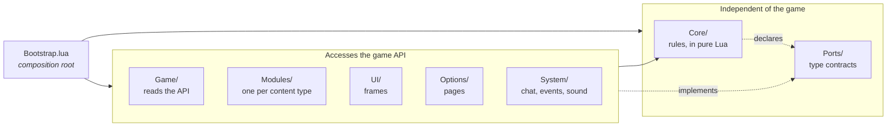
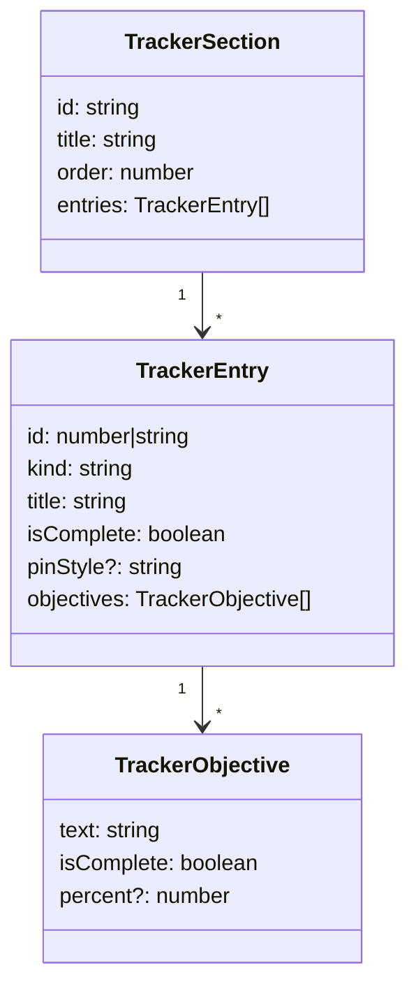

# Architecture

**English** | [Português](pt-BR/arquitetura.md)

## The dependency rule

**Dependencies point inward.** `Core/` does not reference any other layer; the
outer layers reference `Core/`. Every code layer lives under `Source/`; the
addon root holds only the `.toc`, `Bindings.xml` and the media, locales and
library folders.



`Core/` reaches external resources **only through injected objects**, whose
shape is described in `Ports/`. None of its files call `C_QuestLog`,
`CreateFrame` or `Settings`.

The constraint can be checked:

```sh
grep -rlE "C_[A-Za-z]+\.|CreateFrame|Settings\.|LibStub" Source/Core/
```

If the command prints any path, the rule has been broken.

## Motivation

**There is no test framework inside WoW.** Code coupled to the game API can only
be verified by opening the client and inspecting the result by hand. Decoupled
code runs on any Lua interpreter.

The ~1,400 lines of `Core/` are covered by [pure Lua tests](../Tests/Run.lua) that
run without the client, in milliseconds, in CI.

## The folders

| Folder | Contents | Accesses the game API |
|---|---|---|
| `Core/` | filters, sorting, profiles, section assembly | **no** |
| `Ports/` | type contracts, read by the language server | not code |
| `Locales/` | strings, `enUS` as the default | only `GetLocale()` |
| `Game/` | reads the game API and **draws nothing** | yes |
| `Modules/` | one content type per folder | yes |
| `UI/` | frames | yes |
| `Options/` | options pages | yes |
| `System/` | chat, commands, events, sound, shared media | yes |

`Ports/` is not packaged. These are `---@meta` files, with no executable code,
used by the language server to type the rest. The dependency rule is checked at
edit time, not at run time.

## Main contracts

Three ports hold most of the coupling:

**`SectionProvider`**, `Collect(): TrackerSection[]`. It is the entry point of a
content type into the tracker. The 10 providers are independent of each other.

**`TrackerRenderer`** receives the assembled sections and draws them. `Core/`
defines *what* to show; the renderer defines *how*.

**`EntryActions`** defines how an entry behaves when clicked. The
[`EntryActionRouter`](../Source/Modules/EntryActionRouter.lua) dispatches on
`entry.kind`. The optional methods (`Describe`, `Rewards`, `SuperTrack`) are
checked for presence before the call, instead of requiring inheritance.

## Common data structure

Each provider translates the game's format into a single structure, so the
renderer handles one format instead of ten:



An achievement, a profession recipe and a world quest reach the
`EntryBlockPool` in the same format. That is why the `percent` field started
being drawn as a progress bar for every type at once, with no change to any
provider.

## Load order

The namespace is a flat table (`Addon.QuestFilters`, `Addon.HexColor`), so
moving a file does not break references. Some files, however, **read others at
file scope**, and in those cases the order in the `.toc` is mandatory:

- `Locales/` before everything: the preferences catalog reads the labels on load
- `Preferences/Keys`, `FontFlags`, `SortModes` and `SoundChannels` before
  `Preferences/Catalog`
- `Filtering/FilterIds` before `Filtering/Filters`

The rest resolve their references at run time and can be listed in any order.

## Design decisions

**Own frame instead of modifying Blizzard's.** The previous approach ran into
taint: `SetScale`, `SetPoint` and `Hide` are blocked on frames with a protected
child. Consuming the *data* API instead of the *interface* code reduces exposure
to changes between patches, because the former changes less than the latter.
See [constraints](constraints.md).

**Preferences as data.** Adding a preference means adding an entry to
[`Core/Preferences/Catalog.lua`](../Source/Core/Preferences/Catalog.lua). No
adapter changes: the options panel reads the catalog and creates the matching
control.

**One provider per content type.** Adding a type requires no change to existing
code. See [adding content](adding-content.md).
