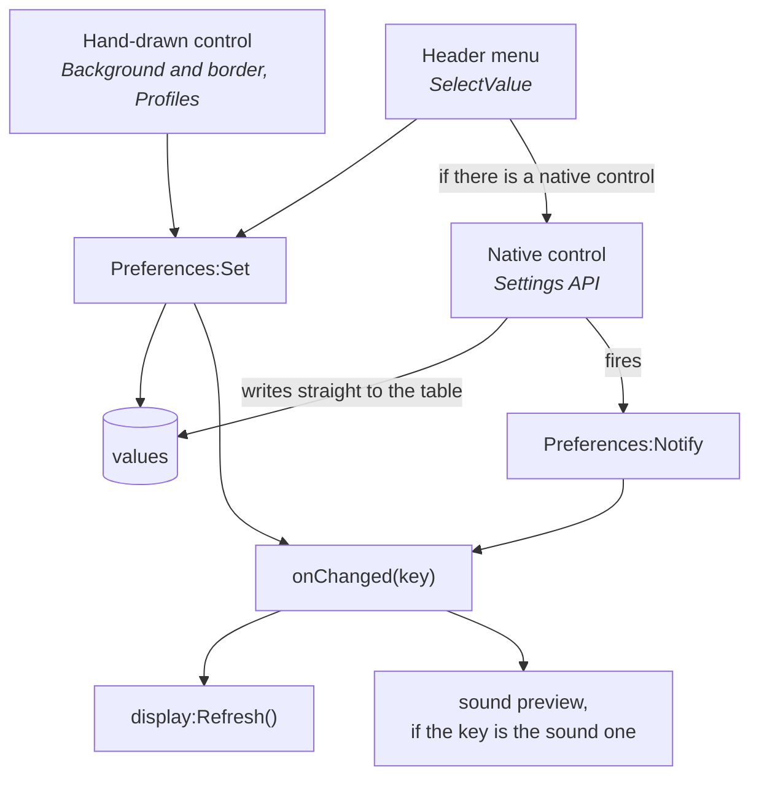
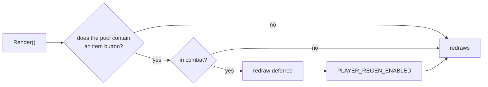

# Execution flow

**English** | [Português](pt-BR/fluxo.md)

## Initialization

Initialization is split into two stages, triggered by different events.

```mermaid
sequenceDiagram
    participant Jogo as Game
    participant Loader as Bootstrap
    participant Build
    participant Start

    Jogo->>Loader: ADDON_LOADED
    Note over Loader: SavedVariables available
    Loader->>Build: Build()
    Build->>Build: profiles, preferences, providers,<br/>renderer, options, buttons
    Jogo->>Loader: PLAYER_LOGIN
    Note over Loader: loading screen finished;<br/>chat keeps the messages
    Loader->>Start: Start()
    Start->>Start: attaches the buttons to the header
    Start->>Start: first Refresh
```

`Build()` runs on `ADDON_LOADED`, the first moment `AuraQuestorDB` is
available. Before any read, `LegacyDatabase.Resolve` decides which table wins:
the new one, if it already has content; otherwise `AuraTrackerQuestorDB`, which
the bridge folder with the old name keeps loaded and which the `.toc` declares
in `OptionalDeps` so it loads first. `Start()` waits for `PLAYER_LOGIN` because
the chat frame restores its history after the loading screen and discards
messages written before that.

When the addon loads with the player already logged in, as on a `/reload`,
`PLAYER_LOGIN` does not fire. The loader handles this case by checking
`IsLoggedIn()` and calling `Start()` immediately.

## Update cycle

The path run on every relevant change in the game.

```mermaid
sequenceDiagram
    participant Jogo as Game
    participant Events as TrackerEvents
    participant Boot as RefreshFromGame
    participant Display as TrackerDisplay
    participant Content as TrackerContent
    participant Providers as 10 SectionProviders
    participant Frame as OwnTrackerFrame
    participant Pool as EntryBlockPool

    Jogo->>Events: QUEST_LOG_UPDATE (in a burst)
    Events->>Events: groups over 0.15 s
    Events->>Boot: a single call
    Boot->>Display: Refresh()
    Display->>Display: hides the Blizzard tracker
    Display->>Display: applies button visibility
    Display->>Content: Build()
    Content->>Providers: Collect()
    Providers-->>Content: TrackerSection[]
    Content->>Content: drops empty sections
    Content->>Content: sorts sections by order
    Content->>Content: sorts entries; completed last
    Content-->>Display: assembled sections
    Display->>Display: applies font, scale, background
    Display->>Frame: Render(visible sections)
    Frame->>Pool: Build(entry) per row
    Boot->>Boot: CompletionWatcher compares with the previous state
    Boot->>Boot: plays the completion sound, if enabled
```

### Debounce

`QUEST_LOG_UPDATE` fires several times in a row for a single quest turn-in.
Without grouping, the tracker would be rebuilt over and over on consecutive
frames. The 0.15 s delay in
[`TrackerEvents`](../Source/System/TrackerEvents.lua) reduces the burst to a single
rebuild. All 26 registered events go through this same grouping.

### Widget reuse

Each rebuild draws up to a few dozen entries. Since WoW does not destroy
frames, creating new ones on every update would pile up widgets for the whole
session. The
[`EntryBlockPool`](../Source/UI/Entry/BlockPool.lua) reuses the existing ones.

## Preference change

There is a single write path. There used to be two, and only one of them fired
the change callback.



`Preferences:Set` does not fire the callback when the received value equals the
current one, so changing a control and returning to the original value redraws
nothing.

## Combat

A quest item button uses `SecureActionButtonTemplate`, which makes **every frame
above it protected**. Moving, resizing or hiding a protected frame during combat
is blocked by the game.



As long as no item button exists, nothing is blocked, which is the most common
case. Turning off **Quest item buttons** in the options prevents any of them
from being created, and the tracker then updates throughout combat.
